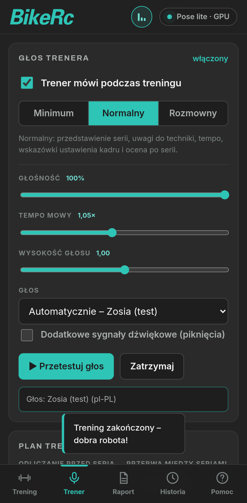
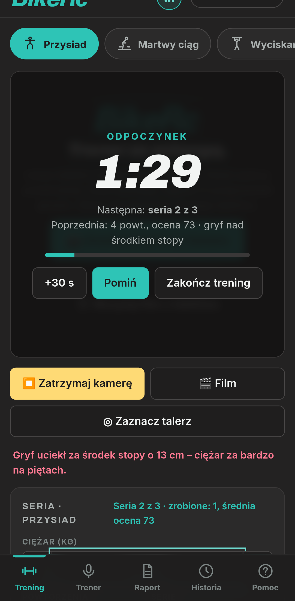
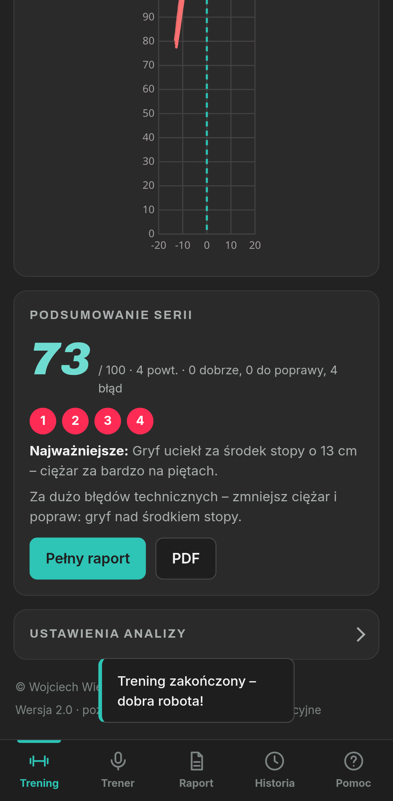
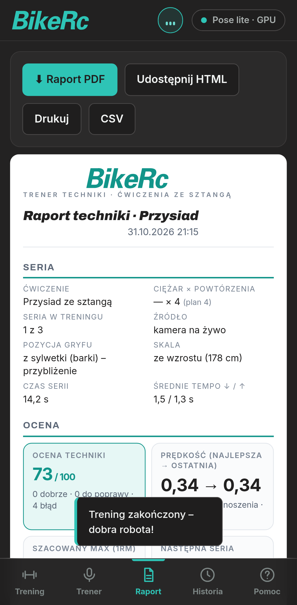

# Ciężary · Trener techniki

Aplikacja przeglądarkowa (PWA) – **głosowy trener techniki ćwiczeń ze sztangą**. Postaw telefon z boku, włącz kamerę
albo wczytaj film: aplikacja liczy powtórzenia, ocenia technikę, mierzy prędkość sztangi i **mówi do Ciebie po polsku**
w trakcie treningu – odlicza, liczy powtórzenia, podpowiada poprawki, pilnuje przerw i podsumowuje serię.
Wszystko działa lokalnie w przeglądarce – **obraz nie jest nigdzie wysyłany**.

**Aplikacja:** https://wwieczor-commits.github.io/ciezary-trener/

© Wojciech Wieczorek · Ciężary · Trener techniki. Logo i kolory: BikeRc.

> ⚠️ Ocena techniki i szacowane wartości (1RM, prędkość) są **orientacyjne** – pomiar z jednej kamery 2D nie zastępuje
> trenera. Dobieraj ciężary rozsądnie, w razie bólu przerwij ćwiczenie.

Nowa wersja aplikacji „BikeRc Siła” (repozytorium `ci-ary-`, które pozostaje bez zmian).

| Trener (głos) | Odpoczynek | Podsumowanie | Raport |
|---|---|---|---|
|  |  |  |  |

## 🎙 Głosowy trener

- **Polski głos** przez Web Speech API (`speechSynthesis`): aplikacja sama wybiera najlepszy głos pl-PL
  (preferuje lokalne/„enhanced”), a gdy go brak – używa głosu domyślnego z językiem pl i pokazuje wskazówkę, jak doinstalować polski głos.
- **Scenariusz treningu**: zapowiedź serii (numer, ćwiczenie, plan, ciężar) → odliczanie 3‑2‑1 z sygnałem → „Start!” →
  numer każdego powtórzenia, „jeszcze jedno”, „to ostatnie!”, „połowa” → uwagi do techniki (jedna, najważniejsza, bez zalewu słów),
  tempo (zbyt szybko / zbyt wolno), pochwały i motywacja, ostrzeżenie o spadku prędkości → **podsumowanie serii** (powtórzenia, ocena,
  co poprawić, sugerowany ciężar) → **odpoczynek z odliczaniem** (połowa, 30 s, 10 s, 3‑2‑1) → automatyczny start kolejnej serii →
  podsumowanie całego treningu.
- **Trzy poziomy rozmowności**: Minimum (liczby i koniec serii), Normalny, Rozmowny.
- **Ustawienia**: głośność, tempo mowy, wysokość głosu, wybór głosu, wyciszenie jednym dotknięciem (przycisk „Trener” na górze i 🔊 na ekranie), sygnały dźwiękowe, test głosu.
- **Napisy**: to, co mówi trener, pojawia się też na obrazie i w dzienniku wypowiedzi – także po wyciszeniu.
- Kolejka z priorytetami (pilne komunikaty przerywają mniej ważne, przeterminowane są pomijane), więc trener nie „plącze się” za ruchem.
- **iPhone/Safari**: mowa jest odblokowywana pierwszym dotknięciem (Uruchom kamerę / Start). Przy wyciszonym przełączniku dzwonka lub w tle
  systemowa mowa bywa wstrzymywana – patrz „Ograniczenia”.
- **Ekran nie gaśnie** podczas treningu (Wake Lock).

## Co potrafi (wszystkie funkcje poprzedniej wersji + nowości)

- **4 ćwiczenia**: przysiad, martwy ciąg, wyciskanie nad głowę, wyciskanie leżąc.
- **Kamera lub film z pliku** (z kontrolkami: 0,25/0,5/1×/2×, krok o klatkę, przewijanie, przeciągnij‑i‑upuść). Przy analizie filmu aplikacja
  sama zwalnia odtwarzanie na wolniejszych telefonach, żeby nie gubić klatek.
- **Szkielet (MediaPipe PoseLandmarker)**: modele lite / full / heavy, GPU lub CPU (z automatycznym przejściem na CPU), wygładzanie (filtr One Euro).
  Biblioteka i modele lite/full są **w repozytorium** (praca offline); heavy pobierany jest z internetu.
- **Wybór osoby** na zatłoczonej sali (dotknij sylwetki); zamiana lewa/prawa strona, lustro.
- **🔒 Prywatność (v2.1, domyślnie włączona):** tło jest rozmywane maską segmentacji MediaPipe – ostra zostaje sylwetka, strefy dłoni/stóp oraz sztanga z jej torem. Brak świeżej maski = rozmyty cały kadr (tryb „fail-closed”). Dotyczy podglądu, filmu, zrzutów, nagrań, raportu i PDF; przełącznik 🔒 na podglądzie lub w ustawieniach, zapamiętywany. Zdjęcia w raporcie mają dopisek „tło rozmyte”. Test: `tests/test_privacy.py` (zrzuty `screenshots/privacy-blur-on.png` / `-off.png` z klipu stockowego).
- **Śledzenie talerza** (dopasowanie wzorca NCC) z przeliczeniem pikseli na centymetry z średnicy talerza (albo ze wzrostu użytkownika).
- **Licznik powtórzeń** (automat stanów), oceny techniki dla każdego powtórzenia (ok / uwaga / błąd), ocena serii 0–100, prędkość sztangi,
  spadek prędkości w serii, **szacowane 1RM (Epley)**, sugestia następnego ciężaru, tor sztangi.
- **Zdjęcia** najlepszego i najgorszego powtórzenia.
- **Seria wielu serii**: plan powtórzeń i liczby serii, odliczanie, przerwa, automatyczne kończenie po zadanej liczbie powtórzeń.
- **Raport**: podgląd, udostępnianie HTML, drukowanie/**PDF** (jsPDF, polskie znaki), **CSV**.
- **Historia** (do 300 serii), tabela postępów, eksport/import **JSON**.
- **Pomoc** z ustawieniem telefonu dla każdego ćwiczenia.
- **PWA**: instalacja, dolny pasek nawigacji, praca offline po pierwszym wejściu; `index.html` i kod aplikacji ładowane *network‑first*
  (nowa wersja trafia do użytkownika od razu).

### Dane i migracja
Historia i ustawienia są w `localStorage` pod nowymi kluczami (`ciezary_trener_*`). Serie ze starej wersji
(`bikerc_sila_history_v1`, ustawienia `bikerc_sila_settings_v1`) – jeśli są w tej przeglądarce – są **kopiowane** (oryginały zostają nietknięte):
ustawienia automatycznie, a historię importujesz jednym przyciskiem w zakładce *Historia*.

## Jak nagrywać
- Telefon oprzyj stabilnie, **z boku** (ok. 90° do płaszczyzny ruchu), na wysokości bioder/talerza; w kadrze cała sylwetka i sztanga.
- Dobre, równe światło; ubranie kontrastowe z tłem. Aplikacja podpowiada (także głosem), gdy nie widzi stóp lub sylwetki.
- Na filmach z iPhone’a w HEVC (.mov), których przeglądarka nie odtworzy, zapisz plik jako „Najbardziej zgodny”/MP4 H.264.

## Uruchomienie lokalne
Statyczna strona bez budowania:

```bash
python3 -m http.server 8099   # i otwórz http://localhost:8099/
```
Kamera wymaga HTTPS albo `localhost`.

## Struktura
`index.html`, `style.css`, `report.css`, `sw.js`, `manifest.webmanifest`, `js/` (`app.js` – interfejs i przepływ serii, `engine.js` – szkielet,
filtry, automat powtórzeń i ocena techniki, `coach.js` – głos i scenariusz trenera, `report.js` – raport HTML/PDF, `store.js` – dane i migracja, `util.js`),
`assets/` (czcionki, logo, ikony, jsPDF, MediaPipe + modele).

## Testy
`python3 tests/test_app.py` (Playwright + Chrome; Pixel 7, iPhone 13, komputer): brak błędów JS, brak przewijania poziomego, wszystkie zakładki,
seria z syntetycznym szkieletem (powtórzenia, auto‑koniec, podsumowanie, historia, raport, PDF, CSV, JSON), przepływ odliczanie → seria → przerwa → seria 2,
**wypowiedzi trenera** (atrapa `speechSynthesis` zapisuje teksty), zapis ustawień głosu, tryb bez głosów, migracja ze starej wersji
oraz – lokalnie – wczytanie filmu i kamera z nagrania. Filmy testowe są prywatne i nie ma ich w repozytorium. `tests/shots.py` – zrzuty do README.

## Ograniczenia
- Analiza 2D z jednej kamery – wartości (kąty, prędkość, cm, 1RM) są przybliżone i zależą od ustawienia telefonu.
- Mowa w przeglądarce: jakość i dostępność polskiego głosu zależą od systemu; w tle (zablokowany ekran) i przy wyciszonym przełączniku iPhone’a może milczeć.
- Wake Lock nie działa na iOS < 16.4. Model *heavy* wymaga internetu przy pierwszym użyciu.
- Filmy w HEVC (.mov) nie zawsze da się odtworzyć w przeglądarce.
- Prototyp – nie zastępuje trenera ani porady lekarza.
